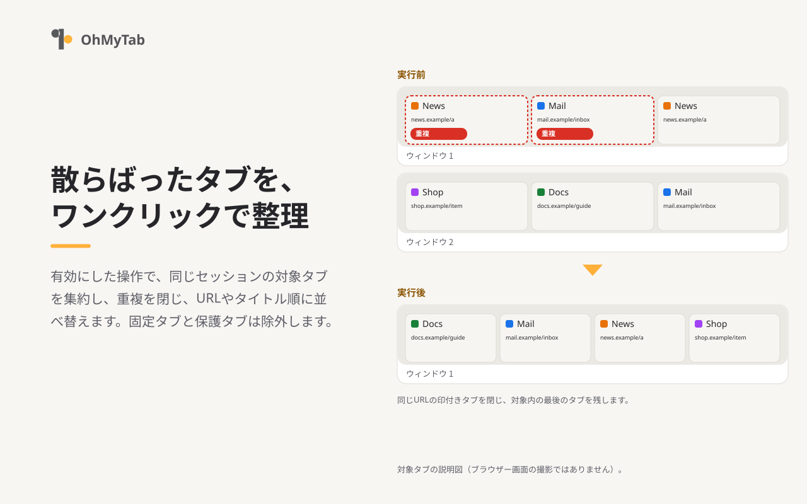

# OhMyTab

[English](README.md) / 日本語 / [中文 (简体)](README-zh_CN.md)

**OhMyTab** は、散らばったタブをワンクリックで整理できるブラウザー拡張機能です。Chrome、Edge、Brave、Firefoxに対応し、ウィンドウの集約、重複タブの削除、並べ替え、URLパターンによる不要なタブの整理などを一括で行います。さらにChrome、Edge、Braveでは、同一ドメインのタブをグループにまとめることもできます。



## 基本的な使い方

インストール直後の初期設定の状態でツールバーのOhMyTabボタンをクリックすると、以下の操作がまとめて実行されます。

1. 同一セッション（通常またはプライベート）内のすべてのタブを1つのウィンドウに集約
2. 同一URLの重複タブを削除
3. タブをURL順に並べ替え
4. メモリー節約のために休止状態になったタブを再読み込み

各操作は、設定画面から個別にオン・オフを切り替えられます。

## バージョン 3.0.0の主な変更点

- **整理手順の保存:** 対象ウィンドウ、実行する操作、URL条件の組み合わせに名前を付けて保存し、ページの右クリックメニューから実行できるようになりました。実行前に閉じる対象のタブを確認できます。
- **実行前の確認・保護・復元:** 整理実行前の確認画面（初期設定はオフ）を追加しました。また、指定ドメイン・音声再生中・既存グループ内のタブを保護する機能や、直前に閉じたWebページ（5分以内に閉じた最大50件）の復元機能を追加しました。
- **設定のバックアップ:** 設定のJSON形式でのエクスポートとインポートに対応しました。URLパターンについては、ブラウザーの同期機能を使わず、端末内（ローカル）のみへの保存も選択できます。
- **ビルドと開発ツール:** Chrome用とFirefox用でビルドを分離し、開発ツールをTypeScriptへ移行しました。

すべての変更点は[変更履歴](CHANGELOG.md#日本語)をご覧ください。

## 主な機能

### ツールバーボタンの操作

- すべてのウィンドウのタブを1つに集約
- 同じURLの重複タブの削除
- URLまたはタイトル順での並べ替え
- ブラウザーの内部ページ、検索結果、ローカルファイルのタブを閉じる
- URLパターン（`*` を使うglob形式。正規表現は非対応）に合致するタブを閉じる
- メモリー節約のために休止したタブの再読み込み
- 同じドメインのタブのグループ化（Firefoxを除く）

### 右クリックメニューの操作

- 同じサイトのタブを閉じる
- 同じサイトのタブを新しいウィンドウへ移動
- タブを1つのウィンドウに集約
- このタブを新しいウィンドウへ移動
- 保存した整理手順の実行

### 仕様・注意事項

- ツールバーボタンは、設定画面で有効にした操作をまとめて実行します。アイコンには、開いているタブの数（全体またはウィンドウごと）を表示できます。
- 固定（ピン留め）されたタブは操作対象外です。
- 通常ウィンドウとプライベートウィンドウをまたいだ操作は行いません。Firefoxではコンテナー間の操作も行いません。

## 対応ブラウザー

| ブラウザー | バージョン | 備考 |
| --- | --- | --- |
| **Chrome**（PC版） | 123以降 | すべての機能を利用可能 |
| **Edge、Brave**（PC版） | 156で動作確認 | Chrome用ビルドを使用。全機能利用可能（端末間の同期は未確認） |
| **Firefox**（PC版） | 112以降 | タブのグループ化は非対応。Android版は対象外 |

詳細は[ブラウザー対応](docs/browser-support.ja.md)をご覧ください。

## ソースからの導入

Node.js（22系はv22.18以降、24系、または26系以降）およびpnpm 12が必要です。

1. 依存関係のインストールとビルド

   ```sh
   pnpm install --frozen-lockfile
   pnpm run build
   ```

2. ブラウザーへの読み込み
   - **Chrome / Edge / Brave:** 拡張機能の管理画面（`chrome://extensions`、`edge://extensions`、`brave://extensions`）で「デベロッパーモード」をオンにし、「パッケージ化されていない拡張機能を読み込む」から `dist_chrome/` フォルダーを選択します。
   - **Firefox:** `about:debugging#/runtime/this-firefox` を開き、「一時的なアドオンを読み込む」から `dist_firefox/manifest.json` を選択します。

配布用パッケージの作成とテストの手順は[開発手順](docs/development.ja.md)をご覧ください。

## プライバシー

OhMyTabは、ユーザーの利用状況や閲覧中のタブ情報を開発者へ送信することはありません。タブ情報の処理はすべてブラウザー内で完結します。

設定データはブラウザーの同期用ストレージに保存されるため、URLパターンや保護対象ドメインが、ブラウザーのアカウントを通じて他の端末へ同期される場合があります（URLパターンのみ、端末内への保存も選択できます）。詳細は[プライバシー説明](resource/store/privacy.md)をご覧ください。

## ドキュメント

- [使い方](docs/usage-ja.md): 操作、整理手順、保護、設定
- [ドキュメント案内](docs/README-ja.md)
- [変更履歴](CHANGELOG.md#日本語)

## ライセンス

[GNU General Public License v3.0](LICENSE)
