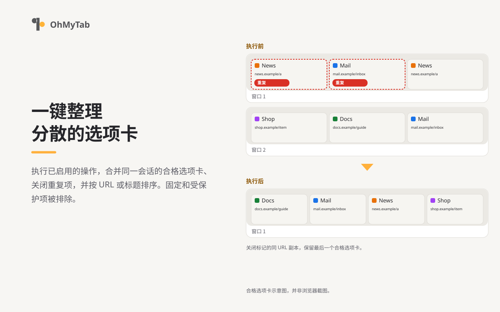

# OhMyTab

[English](README.md) / [日本語](README-ja.md) / 中文 (简体)

**OhMyTab** 是一个一键整理分散标签页的浏览器扩展。它可在 Chrome、Edge、Brave 和 Firefox 上运行，用于合并窗口、关闭重复标签页、排列标签页，以及关闭与特定 URL 模式匹配的标签页。在 Chrome、Edge 和 Brave 上，它还可以将同一域名的标签页分组。



## 基本用法

在安装后的默认设置下，点击工具栏上的 OhMyTab 按钮，会一次性执行以下操作：

1. 将同一会话（普通或隐私）中所有窗口的标签页合并到一个窗口
2. 关闭 URL 相同的重复标签页
3. 按 URL 排列标签页
4. 重新加载为节省内存而休眠的标签页

每项操作都可以在选项页面中单独开启或关闭。

## 版本 3.0.0 的主要变更

- **保存工作流：** 将目标窗口、操作和 URL 条件组合命名并保存，即可从页面的右键菜单中运行。运行前可以检查将要关闭的标签页。
- **执行前预览、保护与撤销：** 添加了可选的执行前预览画面（默认关闭）；可根据域名、音频播放状态或现有分组来保护标签页；此外还加入了撤销功能，可恢复最近关闭的网页（最多恢复 5 分钟内关闭的 50 个标签页）。
- **设置备份：** 支持以 JSON 格式导出和导入设置。URL 模式现在可以选择仅保存在本机，而不通过浏览器同步。
- **构建与开发工具：** 分离了 Chrome 和 Firefox 的构建版本，开发工具已迁移至 TypeScript。

全部变更请参阅[更新记录](CHANGELOG.md#简体中文)。

## 主要功能

### 工具栏按钮的操作

- 将所有窗口的标签页合并到一个窗口
- 关闭 URL 相同的重复标签页
- 按 URL 或标题排列标签页
- 关闭浏览器内部页面、搜索结果和本地文件
- 关闭与 URL 模式（使用 `*` 的 glob 模式，不支持正则表达式）匹配的标签页
- 重新加载为节省内存而休眠的标签页
- 将同一域名的标签页分组（Firefox 除外）

### 右键菜单的操作

- 关闭同一网站的标签页
- 将同一网站的标签页移到新窗口
- 将标签页合并到一个窗口
- 将当前标签页移到新窗口
- 运行已保存的工作流

### 说明与注意事项

- 工具栏按钮会一次性执行在选项页面中启用的所有操作。图标可以显示当前打开的标签页数量（全部或每个窗口）。
- 不会更改已固定的标签页。
- 操作不会跨越普通窗口与隐私窗口，也不会跨越 Firefox 的容器（Containers）。

## 支持的浏览器

| 浏览器 | 版本 | 说明 |
| --- | --- | --- |
| **Chrome**（桌面版） | 123 及以上 | 可使用全部功能 |
| **Edge、Brave**（桌面版） | 已在 156 上测试 | 使用 Chrome 构建版本；可使用全部功能（设备间同步未经测试） |
| **Firefox**（桌面版） | 112 及以上 | 不支持标签页分组。不支持 Android 版 |

详情请参阅[浏览器支持](docs/browser-support.ja.md)（日语）。

## 从源码安装

需要 Node.js（22 系列为 v22.18 及以上、24，或 26 及以上）和 pnpm 12。

1. 安装依赖并构建：

   ```sh
   pnpm install --frozen-lockfile
   pnpm run build
   ```

2. 将构建结果载入浏览器：
   - **Chrome / Edge / Brave：** 在扩展程序页面（`chrome://extensions`、`edge://extensions` 或 `brave://extensions`）开启“开发者模式”，点击“加载已解压的扩展程序”，然后选择 `dist_chrome/` 文件夹。
   - **Firefox：** 打开 `about:debugging#/runtime/this-firefox`，点击“临时载入附加组件”，然后选择 `dist_firefox/manifest.json`。

打包和测试指南请参阅[开发流程](docs/development.ja.md)（日语）。

## 隐私

OhMyTab 不会向开发者发送您的使用数据或标签页信息。标签页信息仅在浏览器内进行处理。

设置数据保存在浏览器的同步存储中，因此您的 URL 模式和受保护的域名可能会通过浏览器账户同步到其他设备（URL 模式也可选择仅保存在本机）。详情请参阅[隐私说明](resource/store/privacy.md)（英语/日语）。

## 文档

- [使用指南](docs/usage-zh_CN.md)：操作、工作流、保护、设置
- [文档索引](docs/README-zh_CN.md)
- [更新记录](CHANGELOG.md#简体中文)

## 许可证

[GNU General Public License v3.0](LICENSE)
