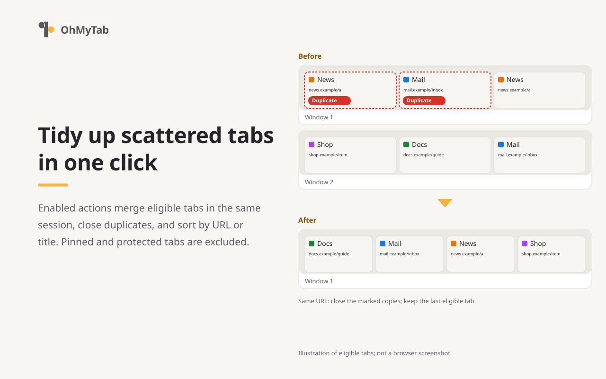

# OhMyTab

English / [日本語](README-ja.md) / [中文 (简体)](README-zh_CN.md)

**OhMyTab** is a browser extension that tidies scattered tabs in one click. It runs on Chrome, Edge, Brave, and Firefox, merging windows, closing duplicate tabs, sorting tabs, and closing tabs that match specific URL patterns. On Chrome, Edge, and Brave, it can also group tabs from the same domain.



## Basic usage

With the default settings upon installation, clicking the OhMyTab toolbar button runs the following actions together:

1. Merge the tabs of all windows in the same session (normal or private) into one window.
2. Close duplicate tabs with the same URL.
3. Sort tabs by URL.
4. Reload tabs that the browser discarded to save memory.

Each action can be toggled on or off individually on the options page.

## Main changes in version 3.0.0

- **Saved workflows:** Save a named routine (window scope, operations, and URL conditions) and run it from a page's right-click menu. You can inspect which tabs will be closed before running it.
- **Preview, protection, and undo:** Added an optional preview before running (off by default); tab protection by domain, audio playback, or existing group; and an undo function for the most recently closed web pages (up to 50 tabs, within 5 minutes).
- **Settings backup:** Export and import settings as a JSON file. URL patterns can now be stored locally on the device instead of using browser sync.
- **Build and tooling:** Separated Chrome and Firefox builds, and migrated development tooling to TypeScript.

See the [changelog](CHANGELOG.md#english) for a complete list of changes.

## Main features

### Toolbar button actions

- Merge tabs from all windows into one
- Close duplicate tabs with the same URL
- Sort tabs by URL or title
- Close browser internal pages, search results, and local files
- Close tabs matching URL patterns (glob patterns using `*`; regular expressions are not supported)
- Reload tabs the browser discarded to save memory
- Group tabs of the same domain (not available in Firefox)

### Right-click menu actions

- Close tabs of the same site
- Move tabs of the same site to a new window
- Merge tabs into one window
- Move the current tab to a new window
- Run a saved workflow

### Specifications and notes

- The toolbar button runs all actions enabled on the options page at once. The icon can display the number of open tabs, either in total or per window.
- Pinned tabs are never modified.
- Operations do not cross between normal and private windows, or between Firefox containers.

## Supported browsers

| Browser | Version | Notes |
| --- | --- | --- |
| **Chrome** (desktop) | 123 or later | All features available |
| **Edge, Brave** (desktop) | Tested on 156 | Uses the Chrome build; all features available (device sync untested) |
| **Firefox** (desktop) | 112 or later | Tab grouping is not supported. The Android version is not supported. |

See [browser support](docs/browser-support.ja.md) (Japanese) for details.

## Install from source

Requires Node.js (v22.18+ for the 22 line, 24, or 26+) and pnpm 12.

1. Install dependencies and build:

   ```sh
   pnpm install --frozen-lockfile
   pnpm run build
   ```

2. Load the build into the browser:
   - **Chrome / Edge / Brave:** Go to the extensions page (`chrome://extensions`, `edge://extensions`, or `brave://extensions`), turn on "Developer mode", click "Load unpacked", and select the `dist_chrome/` folder.
   - **Firefox:** Go to `about:debugging#/runtime/this-firefox`, click "Load Temporary Add-on", and select `dist_firefox/manifest.json`.

For packaging and testing instructions, see the [development guide](docs/development.ja.md) (Japanese).

## Privacy

OhMyTab does not send usage data or information about your tabs to its developer. Tab information is processed strictly within the browser.

Settings are saved in the browser's sync storage, so your URL patterns and protected domains may sync across devices through your browser account (URL patterns can optionally be stored locally on the device instead). See the [privacy practices](resource/store/privacy.md) for details.

## Documentation

- [Usage](docs/usage.md): actions, saved workflows, protection, settings
- [Documentation index](docs/README.md)
- [Changelog](CHANGELOG.md#english)

## License

[GNU General Public License v3.0](LICENSE)
